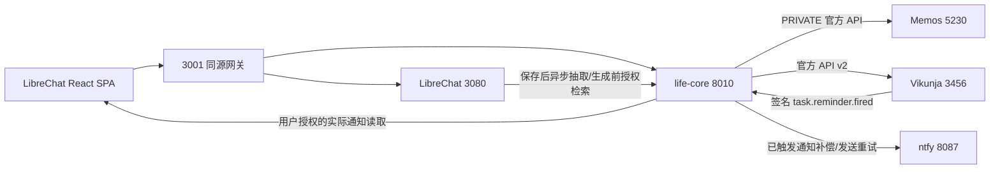

# V0.2.1 记忆、回忆与成熟提醒服务

记录日期：2026-11-02。总体状态 **PARTIAL**。本文描述本机实际实现；不代表公网、手机或所有自然语言场景通过验收。

## 记忆边界

- LibreChat 保存原始聊天；life-core 是产品记忆唯一管理中心；Memos 保存已发布的私人生活事件。
- 保存消息后，服务端调用 `/internal/v1/events/enqueue`。SQLite 抽取工作记录可重试；成功后清除任务中的原文，抽取故障不阻断聊天。
- DeepSeek 输出受 Pydantic 校验的候选，确定性规则复核来源、否定、未来、授权、敏感类别、类型和规范键。当前每条消息至多一个候选，尚不是通用多候选抽取器。
- 事实、生活事件、未来计划和普通聊天分流；当前事实规范化重点是饮品偏好、居住信息，事件归并重点包括同会话同日的项目组事件。
- `memory_items`、`memory_evidence`、`memory_revisions` 分别保存状态、证据和修订。跨独立日期/会话证据可强化重要性；复制、相同来源重试不虚增。重要性与模型信心、有效状态分开。
- 新明确纠正使旧事实失效；撤回先阻断召回，再删除衍生 Memo，失败进入可重试清理记录。原始聊天仍由 LibreChat 管理。
- 自动整理、使用既有事实、敏感内容和主动通知分目的授权。无授权不无限保存候选；原生 LibreChat Memory 独立写入关闭。生图没有启用。
- 生成前通过 `/internal/v1/knowledge/recall` 取得最多四条相关事实，作为不可信证据，不修改原始用户聊天。未使用全量聊天拼接，也未宣称通用向量 RAG。
- UI `/memory-settings` 支持查看、纠正、删除和授权；回忆正文隐藏本系统生成的内部审计尾注，来源对话仍可打开，原 Memos 内容未被改写。

## 提醒边界

固定上游及镜像 digest 见 `evidence/v02-memory-reminders/upstream-lock.json`：

| 服务 | tag | commit |
| --- | --- | --- |
| Vikunja | v2.7.1 | 5619c4a9f66ddfc13f7bbba24ada07c3e82ae7a0 |
| ntfy | v2.36.0 | 2d55160690708670895ae10d9895bde90241e38d |

均为保留完整 Git 历史和许可证的独立仓库，上游源码未改。Vikunja 为 AGPL-3.0-or-later；ntfy 保留 Apache-2.0/GPLv2 许可证文件。对外服务前仍需处理适用的源码提供义务。

Vikunja 负责真正的任务状态与到期调度，ntfy 负责消息分发。life-core 仅做身份、授权、API 转换、来源幂等、Webhook 验签、已触发通知补偿和发送 outbox。

| life-core API | 用途 |
| --- | --- |
| `POST/GET /api/v1/reminders` | 当前用户创建/查询 |
| `GET/PATCH/DELETE /api/v1/reminders/{id}` | 详情、编辑/办完、取消 |
| `GET /api/v1/reminder-notifications` | 服务端使用用户专属凭据读取 ntfy |
| `POST /internal/v1/reminders/execute` | 内部自然语言动作执行 |
| `POST /api/v1/webhooks/vikunja` | 原始 body 的 HMAC 验签，网关不公开 |

实际调用的 Vikunja v2 路由：`POST /projects/{id}/tasks`、`GET /tasks`、`GET/PUT/DELETE /tasks/{id}`、`POST /tokens`、`POST /user/settings/webhooks`、`GET /notifications`。v2 列表是 `items` 包装，不按 v1 数组解析。OpenAPI 原始文件已归档。

自然语言只对明确提醒请求执行。时间、对象不明则澄清；单纯未来计划不自动创建。模型在真实后端结果到达后才能声称成功；相同用户与消息来源保存执行结果，未知结果不自动重复提交。

每个合成 SPA A/B 账号具有独立 Vikunja 用户、项目、受限 token、Webhook secret、ntfy 凭据与 ACL topic；运行配置仅存 ignored `infra/runtime/reminders/`。未实现普通用户自动开户。测试 token 七天后需服务端续期。

## 时间与可靠性

- 只接受带偏移的将来时间和有效 IANA 时区；按用户时区解释自然语言。
- 原版 Vikunja 以分钟扫描下一分钟提醒；适配器将含秒请求向后归整到整分钟，并展示实际安排时间，避免无声提前。当前不提供秒级承诺。
- 校验签名、用户、任务归属和当前提醒时间；取消、完成、过时回调不投递。相同用户/任务/安排时间只入队一次。
- outbox 使用 SQLite 原子领取；进程重启恢复未确认项。失败退避重试；重试先通过 ntfy 官方缓存核对 `X-Sequence-ID`。
- Webhook 遗漏时只读取 Vikunja 自己已触发的持久通知，**不由 life-core 按本地时钟扫描任务并触发提醒**。
- `accepted` 仅代表 ntfy 接受。站内列表可读取真实消息；不等于 OS 通知、关页后台通知或手机送达确认。缓存窗口外不保证 exactly-once。

## 尚未满足的验收门槛

1. 固定每周/每日无需完成的重复提醒尚未交付。锁定源码 `pkg/models/tasks.go` 的重复任务是在标记完成时推进；不能把它冒充独立周历调度。现阶段明确拒绝并请求单次日期，不静默降级。
2. 没有 OS Web Push/手机/关页通知验收；本机 HTTP 与 nonroutable webhook 配置仅供隔离测试。
3. 手工创建 API 没有完整请求幂等键；上游创建成功、本地映射写入失败仍可能产生孤儿任务。
4. 补偿读取最近一页官方通知，极端积压、缓存过期、并发编辑取消边界仍需加强。
5. 无通用“刚才那个”会话动作引用模型；唯一候选以外应澄清。多候选记忆、广泛实体/事实关系、真实跨自然日持续使用仍待验收。
6. JWT 沿用上游到期语义，未新增即时撤销；没有多用户自助开户、图片 Provider、APK 或公网部署。

命令、失败与截图入口：`evidence/v02-memory-reminders/README.md`；独立阶段日志见 `docs/development-log/README.md`。
