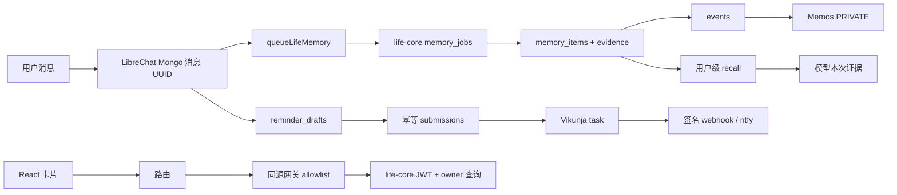

# V0.2.3 已证实根因与待验证项

2026-11-03。以下根因来自现有代码与只读数据库检查。

| 缺陷 | 实际调用链与根因 | 修复点 |
| --- | --- | --- |
| 已创建提醒无法直接看详情 | ReminderCards.tsx 的 Link 固定 `/reminders`；routes/index.tsx 仅有列表；life-core 已有受 owner 约束的详情 GET；data-provider 没有详情方法 | 增加真实 ID 的详情路由、API 方法、来源返回 |
| 候选点击不是业务详情 | `href=#source_message_id` + preventDefault + scrollIntoView 只滚动原消息 | 保留来源按钮，独立业务入口，不能混称 |
| 已知信息仍大表单 | ReminderDrafts.extract 只有识别地点才确定 timezone/today；无地点相对日期失效。只硬编码高铁标题；LLM 缺省字段与规则无上下文补齐 | 用户 IANA 区+服务器时钟确定日期，拆分事件和通知时间，保留原文约束 |
| 表单重复确认 | ReminderChat.execute 将所有创建请求转为待确认；ReminderCard 默认显示日期/时间/提前量/时区，即使字段已存在 | 仅缺项 Chip，一次选择原子补全与幂等创建；完整请求直接创建 |
| 取消后模型状态不同步 | REFERENCE 分支先于取消处理；始终创建引用草稿。召回仅 memory_items 不包含真实 reminder 状态 | 唯一引用取消真实任务，多项才选择；查询当前状态 |
| U盘/雨伞跨会话丢失 | MemoryService.classify 在 LLM 之前 FUTURE 命中就 return；_llm 仅允许 drink_preference/residence 事实；未来事项不入 memory_items | 独立 future_plan 类型，不冒充发生过的事件；来源、授权与纠正/撤回 |
| 多项召回不足 | recall 仅 bigram 交集，Top4，不理解“带哪些东西”主题；内部 recall 返回只 text/valid_from | 用户隔离的结构化主题+关键词召回，业务来源稳定 ID，任务状态 |
| 来源 ID 混淆 | queueLifeMemory 用 savedMessage._id（Mongo ID）而非 messageId（聊天 UUID）；UI 不能用它精确定位消息 | 使用已保存的 messageId，历史值保持原样不迁移 |
| 聊天没有记忆入口 | 三条内容渲染路径仅挂 ReminderCards；Knowledge 只显示 stable_fact，缺记忆详情；GET knowledge/{id} 不存在且网关不允许 | 来源关系 API、可刷新详情、所有持久类型展示 |
| 回忆无图与调度 | memories 实际是已发布 Memos 生活事件；没有 moment 表、图片提供商、三窗队列或自动生成设置 | 在 C 稳定后增量实现衍生作品，状态真实 |

待验证：所有手机尺寸入口、完整 GLM 联调的实际话术、重复触发、图片模型权限与余额。
没有证据证明 Qdrant 已接入本产品，不新增重依赖来掩盖未写入的问题。
旧权限异常无调用日志，仍 PARTIAL；设备送达 UNKNOWN；Lighthouse 需本轮重测。
