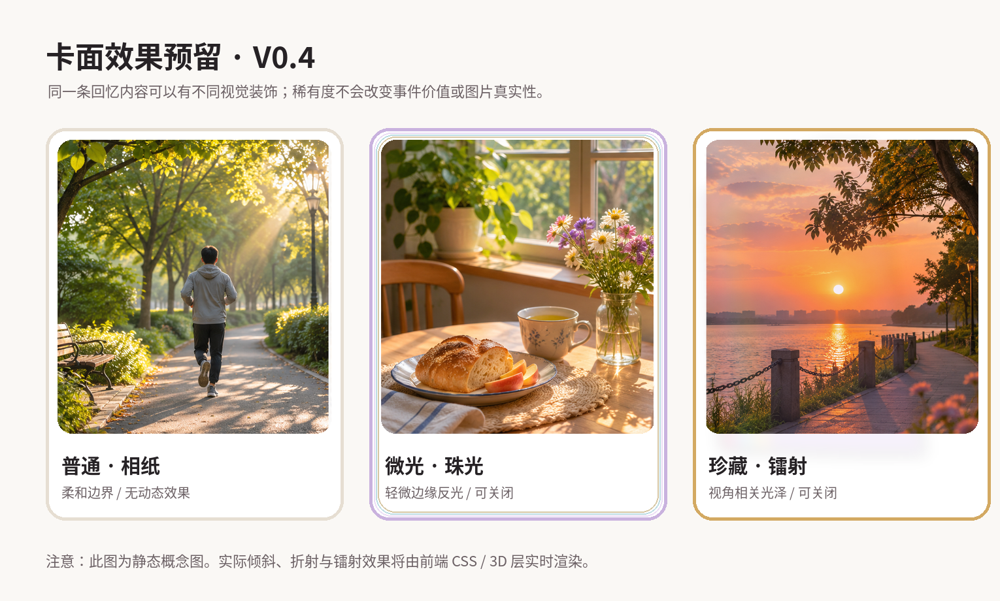
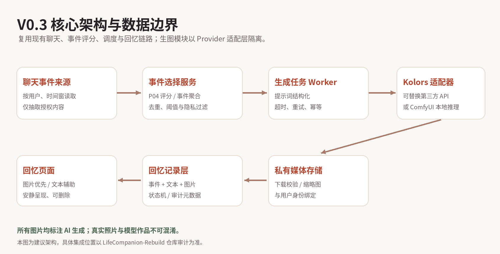
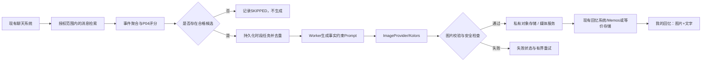
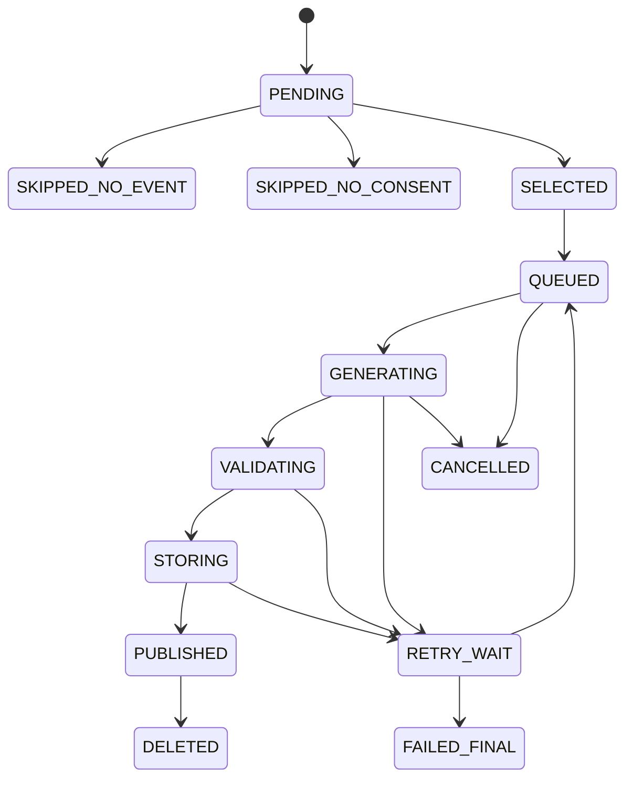

# LifeCompanion-Rebuild V0.3｜自动图文回忆生成系统开发文档

> 文档版本：v1.0 · 2026-11-04  
> 定位：**供产品评审、技术审查与 Codex 分阶段实施的正式方案**（不是立即无条件执行的代码指令）  
> 当前范围：事件筛选 → 三时段调度 → Kolors 生图 → 私有存储 → 图文回忆展示  
> 后续范围：V0.4 稀有卡、微光、镭射和收藏视觉效果  
> **说明：本文的图片均为虚构生活场景或静态 UI 概念示意，非真实用户照片、非实际 Kolors API 输出、非已实现界面截图。**

---

## 0. 一页结论

**产品目标**：用户只需像平时一样与 LifeCompanion 聊天；系统在每天三个时段的末尾，从获得授权的聊天中选择**最多一件值得记录的生活事件**，生成一张与事件相符的 AI 画面，并将「画面 + 标题 + 文字 + 日期/时段」静默归档至“我的回忆”。用户下次打开应用时自然发现，而非被通知催促。

**核心原则**：

1. **每天最多三张，不是强制三张**。当时段无聊天、无有效事件、未授权或安全检查不通过时不生成。
2. **真实事件优先**。AI 可以创造画面，不能捏造用户发生过的经历。必须标注“AI 创作画面”，避免被误认为现场照片。
3. **默认静默**。不要求用户输入“帮我生成”，不在生成完成时强制推送；允许用户关闭自动生图、管理和删除自己的回忆。
4. **现有功能优先复用**。不重做聊天、记忆、提醒、认证或导航；不能仅因本方案提到某个技术栈就推断仓库已安装。
5. **模型与图像效果解耦**。Kolors 可以被替换；V0.4 稀有卡视觉装饰不改变原始图片和事件含义。
6. **以验收证据为准**。Mock 成功不能冒充真实生图；图像服务返回成功不能冒充私有存储或前端展示完成。

### 0.1 本次交付范围

| 事项 | V0.3 本轮 | V0.4 后续 |
|---|---|---|
| 事件提取、聚合、评分和去重 | 必须 | 维护优化 |
| 三时段自动调度 | 必须 | 可增加偏好 |
| 生图供应商适配器与真实 Kolors 测试 | 必须 | 多 Provider 路由 |
| 私有图片存储、缩略图、归档与删除 | 必须 | 优化存储 |
| 图大字少、图文结合的回忆页 | 必须 | 保持 |
| 普通卡外观与未来效果字段 | 仅预留 | 完整实现 |
| 随机微光、镭射、稀有卡揭示 | 不做 | 必须另行评审 |
| 付费抽卡、强制签到、连续使用奖励 | 不做 | **不建议引入** |

### 0.2 先核对现有工程，不以历史口述代替代码

历史讨论中，LifeCompanion-Rebuild 被描述为已有聊天、记忆、事件评分、Memos 回忆和任务系统；另有 V0.2 设计资料出现 Vue 组件文件名，而此前的 Rebuild 方案使用过 React 描述。**实际主仓库代码与运行环境尚未在本次文档编写中审计，故以下是“拟复用方向”，不是“已验证依赖事实”。**

Codex 第一阶段只读核验以下内容，并在报告中写清楚“已存在 / 缺失 / 替代实现 / 不适用”：

- 主工程 `README`、`AGENTS.md`、锁文件、包清单、服务入口、部署脚本、数据库 migration。
- UI 实际框架和路由：React、Vue、其他；当前回忆列表、详情、图片预览组件与设计 Token。
- `docs/design/README.md`、`DESIGN_SYSTEM.md`、`MOTION_SPEC.md` 等真实存在的规范及其优先级。
- 聊天消息实际保存路径、事件识别/评分（P04）、事件追踪字段、消息所属用户/会话关系。
- 调度任务、队列、Worker 和它们的重启恢复、锁、重试机制；是否已有 APScheduler，**不能重复部署第二个调度器**。
- 回忆数据服务、Memos 或其他后端实际接口、私有媒体服务、管理员权限、审计日志。
- 现有 consent/隐私设置和数据删除链路。

**验收口径**：没有找到的组件不要“假设已有”；可以提出适配方案，但实施前在审计表中注明新增原因。

---

## 1. 图片素材与设计说明

以下所有图片位于本文同级目录的 `assets/` 文件夹。复制本文到仓库时，必须同时复制 `assets/`，并保留相对路径。图片供布局参考、Mock 数据和视觉回归；正式系统不应把它们写入真实用户记录。

### 1.1 三时段生活画面原型

| 时段 | 图片 | 场景解读 | 与聊天事实的对应要求 |
|---|---|---|---|
| 上午 |  | 晨间公园、树叶间的光线、一个背影正在跑步；强调生活的开始与轻松感 | 用户确实聊过晨跑；不擅自指定城市、公园、服饰、距离和同伴 |
| 下午 |  | 窗边花瓶、面包、茶与阳光，氛围安静温暖 | 只有聊天真的提到相关饮食/休息事件时才可使用此题材；不可仅因为“下午”就画食物 |
| 晚间 |  | 水边步道、远处落日、宁静的暮色 | 只有真实聊过散步、夕阳或相似经历才可对应；不应将此场景强加给任意晚间闲聊 |

**图像风格备选：**

- **A｜生活摄影感（首推测试）**：自然采光、熟悉生活环境、不过度磨皮和电影化，适合建立“像当天的记录”之感，但必须标识为 AI 创作。
- **B｜柔和插画（备选）**：降低肖像误差的敏感性，更适合不提供真实人像参考的用户。
- **C｜日记拼贴（后续）**：可结合真实用户主动上传的照片、日期标签与 AI 装饰元素，必须明确区分真实素材和生成素材。

**默认约束**：V0.3 不上传用户肖像照，不做真人脸部拟真；如果未来需要 Image-to-Image / 身份一致性，必须独立设计明确授权、删除策略、供应商数据政策、效果评测及可撤销能力。

### 1.2 回忆相册页——图片优先


**图示说明**：按同一天展示最多三张回忆，每张采用大图、时段小标签、简短标题与一句摘要。视觉重心在图片；图片占卡片主要面积。示例为宽屏布局，实际移动端应调整为纵向单列/适合触屏的布局。

**交互要求**：

- 默认按日期倒序排列；同一日按上午、下午、晚间排序。
- 不强制三张都出现。0 张时维持已有空状态，不显示虚假占位回忆；1、2 张也应自然排版。
- 回忆卡点击进入详情；加载阶段用现有骨架屏，失败明确说明且可重试。
- 允许查看“这是根据什么事件生成的”简述（不能默认暴露大量原始聊天或隐私细节）。
- 不因后台新增图像而抢夺当前用户正在阅读的滚动位置。

### 1.3 单张图文详情页——沉浸但不喧宾夺主


**图示说明**：上方标题与日期、中央纵向大图、下方两到三句回忆文字与来源说明。文字来自有事实约束的总结，不允许把模型推测写成既定事实。

**交互要求**：

- 图片可放大、双指缩放、关闭后返回原卡片；优先复用项目已有图片查看工具。如实际已使用 PhotoSwipe 则不另造一个 Lightbox。
- 图片应有稳定的宽高比与 `object-fit` 策略，不随加载产生明显跳动；建议为图片存储 `width/height`。
- 显示 AI 创作标识，默认私有；提供删除、隐藏、反馈“不符合实际”和停止后续自动生图的入口。
- 图片加载失败时保留文本与完整事件信息，不展示破图。
- 保留现有 Ember 主题、字体 Token 与 motion token，勿重新发明配色系统。

### 1.4 稀有卡面概念——仅为 V0.4 预留



**图示说明**：

1. **普通 / 相纸**：纯净相纸风格，细边框，不使用持续动态效果。
2. **微光 / 珠光**：有轻微边缘反光或微渐变，可通过样式层实现。
3. **珍藏 / 镭射**：依视角呈现彩色折射、细腻闪膜或浮光。此图仅是静态效果示意，真实光泽需要 CSS transform、gradient、blend mode，按需配合 Atropos 的指针/触控倾斜交互。

卡面效果必须是**非付费、非商业抽卡的纯外观装饰**，不使用户误以为普通回忆不值得保存；不开启快速闪烁/无限震动，且遵守系统 `prefers-reduced-motion`，允许在设置中关闭所有特殊效果。

### 1.5 系统结构概念图



**图示说明**：聊天内容 → 事件选择 → 异步生成 → Kolors Provider → 私有媒体 → 回忆记录 → 前端展示。需要依据实际仓库确定模块归属和接口位置，不应为了复现此示意图另造已有服务。

---

## 2. 用户故事与业务规则

### 2.1 标准用户故事

> 上午用户说：“今天去公园跑了三公里，回来感觉精神很好。”之后又聊到早饭和工作。系统在上午结算时聚合这些聊天事件，选择最有代表性的一件；如果晨跑事件得分与隐私校验合格，则生成与“晨跑”有关的画面和一段忠于聊天事实的文字。用户不需要点击任何按钮。之后打开“我的回忆”，可以看到这张 AI 创作图像。

**重点**：不是简单提取一条聊天作为 Prompt，也不是每聊一句就立即生成。每天每时段最多一条最终回忆，事件需要可追踪到原始消息集合。

### 2.2 时段定义（建议默认 A）

| 窗口 | 当地时间覆盖 | 结算执行时间 | 特点 |
|---|---|---|---|
| 上午 | 当天 00:00（含）—11:00（不含） | 当天 11:00 以后 | 覆盖清晨至上午 |
| 下午 | 11:00（含）—16:00（不含） | 当天 16:00 以后 | 覆盖午间与下午 |
| 晚间 | 16:00（含）—次日 00:00（不含） | 次日 00:05 | 保留夜间全部事件；第三张可能次日才出现 |

**选择 A 的理由**：完整覆盖自然日，不遗漏 23:00—24:00 的晚间事件，日期归属清晰。**执行延时**（如晚间 00:05）是结算缓冲，并非事件发生时间。应支持后台配置且保留版本。

**备选 B：11:00 / 16:00 / 23:00 当日全部展示**。若产品更重视当天 23:00 前看到三张图，可以选 B，但需明确：23:00 后的聊天属于哪个业务日、是否下个窗口承接，不能无声漏掉，也不允许对同一晚间事件生成两次。选择 B 需先评审边界策略。

**必要约束**：使用用户的 IANA 时区（例如 `Asia/Shanghai`），数据库时间统一 UTC，展示与业务日期按用户时区计算；时区变化和夏令时要测试；调度不可因服务器重启造成重复生成。

### 2.3 事件挑选策略

1. 获取时段内、用户已授权、允许用于回忆的真实聊天数据。
2. 以现有 P04 事件评分为首选（如仓库审计确认存在），先做语义聚合：同一件跑步事件的三条聊天应该合并为一件，不当作三个候选。
3. 为候选保留 `event_id`、`source_message_ids`、事件时间、地点（若明确提供）、关键词、简述和评分解释。
4. 判断是否达到**可配置阈值**及隐私/内容过滤；此处不预设某个分数就一定代表“值得记录”。
5. 排除：空闲寒暄、重复事件、未经证实的模型建议、用户并未发生的未来计划、仅来自 AI 回复的内容。
6. 根据 `event_value` 与 `imageability`（能否不编造细节而形成画面）共同挑选**最多一件**。
7. 无候选则写入 `SKIPPED_NO_EVENT` 等可审计结算状态，**不调用生图 API、不创建虚假回忆**。
8. 同时保留“仅文字回忆”的路径：用户有真实重要事件，但不适宜可视化或无法安全生成图像时，不得为了卡片形式而强行生图。

**处理事实与感受**：可以写“用户说跑完后精神很好”，不应改写成“用户坚持跑步已经一个月”或“用户正在减肥成功”。提示词不能通过增加虚构人物、地点、穿着、天气等提升画面分数。

### 2.4 用户控制

- 自动生图必须有清晰的主动启用/关闭设置及隐私说明；在用户没有明确授权前不得将私密聊天发送给第三方生图供应商。
- 关闭后不再启动新的生图任务；已提交任务应尽可能取消，无法取消的结果不得自动公开或写入用户回忆。
- 已生成回忆允许单条删除、撤销显示；需要说明服务端删除与备份清除的真实边界。
- 管理员只允许查看任务状态、延迟、费用和脱敏报错；默认不可打开用户私密原始聊天或原图。
- 用户反馈“图片不符合实际”时保留纠错原因，后续不自动把错误图作为事实写回长期记忆。

---

## 3. 技术架构（优先复用，避免双系统）

### 3.1 建议链路



### 3.2 分层职责

| 层 | 主要职责 | 不应承担 |
|---|---|---|
| Scheduler | 按用户时区触发“结算意图”，记录窗口与幂等键 | 长时间阻塞等待生成图片 |
| Event Selector | 聚合、去重、评分、筛选可视化事件 | 拼凑不存在的事实 |
| Memory Draft Builder | 生成简短标题/文字和事实边界 | 将推断写入长期记忆为事实 |
| Image Provider | 调用供应商、轮询/获取结果、统一错误码 | 持久化用户业务记录 |
| Image Worker | 异步执行、重试、限流、状态机 | 在 HTTP 请求中同步占用几分钟 |
| Media Storage | 图片校验、私有存储、缩略图、删除、访问控制 | 公开裸 URL 供全网长期访问 |
| Memory Repository | 原子发布图文回忆、来源追踪、搜索展示 | 无来源生成虚假记录 |
| UI | 渲染、反馈、回忆详情、授权/删除/关闭控制 | 直接在浏览器放入供应商 API Key |

建议优先用现有任务系统。若没有持久任务队列，可选择：

- **首选**：既有数据库任务表 + 单独 Worker + 唯一键 + 原子领取，适合 10 人左右初测。
- **备选**：已存在 Redis 时再讨论 RQ、Dramatiq 或 Celery；不能为了本功能无理由新建 Redis、Celery、RabbitMQ 三件套。
- **不推荐**：仅靠进程内内存定时器、不落库、重启后丢任务。

### 3.3 Kolors Provider 抽象（契约，不是已验证的真实 API 路径）

```python
class ImageProvider(Protocol):
    async def generate(self, request: ImageGenerationRequest) -> ImageGenerationResult: ...

# request建议字段：prompt, negative_prompt, width, height,
# seed, timeout_seconds, idempotency_key, trace_id
# result建议字段：provider, provider_job_id, status,
# image_bytes 或受控临时结果URL, mime_type, metadata
```

切忌凭模型的 Hugging Face 页面自行推断“免费 API 地址”。模型权重可开放下载，但免费推理额度、第三方托管服务可用性和 API 调用权限需要分别核实。

**Provider 优先级：**

| 方案 | 适用时点 | 优点 | 局限/风险 | 建议 |
|---|---|---|---|---|
| P1：当前可用的 Kolors 第三方 API | 本轮真实联调 | 不占本机 GPU；接入快 | 配额、稳定性、收费政策、数据处理条款待验证 | 首选，但必须先做真实 API 探针与文档核验 |
| P2：本地 ComfyUI + Kolors | 有可用 GPU 与稳定环境之后 | 控制权高、可排队、可定制工作流 | 部署维护和硬件成本；兼容性须实际测试 | 最优长期备选 |
| P3：Python Diffusers + Kolors | 开发人员需要底层控制时 | 灵活编排、易接 Python 流程 | GPU 占用、环境版本与模型加载压力 | 技术备选 |
| P4：其他商业模型供应商 | Kolors 不可用或质量不合格 | SLA、吞吐能力可能更稳定 | 付费与跨境/数据政策需评审 | 保底方案 |
| P5：Mock Provider（固定测试图） | 自动化/前端/故障测试 | 便于重放和回归、无外部费用 | **不能代表真实生图已验收** | 必须保留测试模式 |

### 3.4 真实 API 接入前应核验的项目

- API 入口、鉴权方式、请求与返回 schema，是否异步任务、是否轮询/回调。
- 单账户/单日限制、并发、速率限制、图像尺寸、超时范围、失败计费、费用与发票政策。
- 上传的文本是否留存、是否用于训练、数据处理地域、隐私政策，以及是否允许存储输出图。
- 生成图是否附水印、内容政策、商用许可；尤其注意 Kolors **模型代码**与**权重商用许可**不能混为一谈。
- 实测 20–30 个真实但虚构的中文生活场景（不含用户隐私），记录成功率、时延、语义一致性和异常情况。

**若“免费 Kolors API”无法稳定复现**：本轮继续完成 Mock 端到端和 Provider 骨架，明确将真实生图验收标为 `BLOCKED_PROVIDER`；绝不把免费网页手动生成冒充可自动化调用的 API。

### 3.5 提示词生成采用“事件结构化 → 文本描述”两步

输入先生成可校验的 JSON，而不是直接把整段聊天传给生图模型。

```json
{
  "event_summary": "早晨去公园跑步，跑完感觉很有精神",
  "time_of_day": "morning",
  "confirmed_facts": ["公园", "跑步", "感到精神很好"],
  "unknown_facts": ["具体公园", "人物面孔", "穿着", "真实天气"],
  "image_direction": "生活摄影感，晨间公园树木与跑步者背影",
  "consent_scope": "approved_conversation_only",
  "real_photo_claim": false
}
```

随后基于结构化字段构建生图 Prompt。将“未证实信息”转为**通用、非身份化的场景设计**，不要让语言模型将猜想当作事实；不要把姓名、电话号码、具体地址、疾病或其他不必要的敏感文本发送到生图供应商。可使用背影、物件、环境特写来避免肖像身份幻觉。

文字回忆和画面 Prompt 要同时受 `confirmed_facts` 限制，并存储模型版本、Prompt 模板版本与生成参数用于后续追溯，但原始完整聊天不应进入可公开访问的图片元数据。

---

## 4. 数据模型与幂等策略

### 4.1 推荐实体（新增或映射到现有表，不得无条件重建）

| 表/实体 | 关键字段（示例） | 作用 |
|---|---|---|
| `memory_window_settlements` | `id,user_id,local_date,slot,timezone,window_start_utc,window_end_utc,policy_version,status` | 每日每时段唯一结算；包括 SKIPPED |
| `memory_event_candidates` | `event_id,settlement_id,source_message_ids,summary,score,score_version,eligible,reason` | 事件来源与选择解释 |
| `image_generation_jobs` | `job_id,settlement_id,idempotency_key,provider,provider_job_id,status,attempts,next_retry_at,error_code` | 调度、幂等、重试、恢复 |
| `memory_media_assets` | `asset_id,owner_user_id,private_storage_key,mime_type,width,height,sha256,generated_by,created_at` | 图片文件与权限隔离 |
| `memory_entries`（或映射现有 Memos） | `memory_id,owner_user_id,settlement_id,source_event_id,title,body,image_asset_id,ai_generated,visibility,status` | 用户最终看见的图文回忆 |
| `memory_card_style`（仅预留） | `memory_id,rarity,card_effect,effect_version,assigned_at` | V0.4 外观字段，V0.3 不进行随机分配 |
| `memory_image_preferences` | `user_id,enabled,style_preference,timezone,consent_version,updated_at` | 授权与显示偏好 |

- 对 `(user_id, local_date, slot)` 建立数据库层面唯一约束；一个时段最多一条最终自动回忆。
- 对 `idempotency_key` 建立唯一约束，且记录 Prompt/策略版本以支持可控重试。**仅用 API 去重不够**，数据库层也必须阻止重复发布。
- 任务、候选、媒体和回忆分别标记所属用户；读取与删除都在服务器侧校验用户身份，不信任前端传来的 `user_id`。
- 若既有库已经具备等价表/外键，应最小扩展，不增加平行数据孤岛。
- 生成与发布不是同一个事务：可以先把图片保存为私有待发布资产，确认回忆写入成功再标记 `PUBLISHED`；失败资产需有定期、安全的清理机制。

### 4.2 状态机



**真实实现应允许生成供应商已执行但回传结果迟到**：通过 `provider_job_id` 和租约/超时后的核验防止重复生成；如果任务取消或用户撤回授权，即使结果晚到也不能自动公开。

### 4.3 调度算法示意

```text
on_slot_close(user_id, local_date, slot):
  ensure user consent and timezone
  insert settlement with unique(user_id, date, slot) or load existing
  if already completed/cancelled: return
  lock this settlement / acquire worker lease
  fetch authorized messages within UTC interval
  aggregate -> score -> filter -> rank candidates
  if no eligible event: persist SKIPPED_NO_EVENT; return
  build constrained memory draft and image prompt
  enqueue idempotent image job
  worker: provider.generate -> validate output -> persist private asset
  publish one authorized memory entry -> mark PUBLISHED
  on error: record typed failure, bounded exponential retry or FAILED_FINAL
```

失败重试须设置上限与冷却，不允许通过无限重试耗尽免费额度或反复生成多张。被判定为认证错误、权限拒绝、配额耗尽的错误，应进入可见的运维状态，不按普通网络抖动无限重试。

---

## 5. 回忆前端与 UI / UX 细则

### 5.1 视觉规范继承

不重做现有项目的设计规范。若仓库仍使用 Ember Token，可沿用此前资料中的暖白 `#FAF8F5`、正文 `#262225`、主动作赤陶 `#B6452D`，**但当前真实 Token 以仓库设计规范为最终依据**。背景、文字、按钮、边框和状态统一调用 Token，而非在业务代码到处写 hex。

- 回忆列表：图片占卡片可见面积约 65%–80%（设计建议，非固定 CSS 常量），标题 1 行为主、摘要 1–2 行。
- 详情页：大图为主体，文本位于下方；图片较窄时可留边，不裁掉人物关键内容。
- 通常先展示缩略图，详情按需请求大图，使用懒加载和缓存策略，合理显示骨架屏。
- 尊重 `prefers-reduced-motion: reduce`，不使用持续漂浮、强烈晃动、快速闪烁。
- 文本对比度参考 WCAG，正文优先确保 4.5:1；触控目标建议不小于 44×44 px。
- 点击删除有二次确认及可理解的后果说明；点击图像可以放大但不强行滚动页面。
- 必须审查 390、430、768、1440、1920 px 宽度以及字号放大场景。

### 5.2 “惊喜感”应如何实现

**不是推送通知制造任务感**，而是用户打开回忆页时，已完成生成的回忆自然出现。第一轮 V0.3 不加入概率揭示动画；可以在新生成回忆首次可见时进行一次轻微淡入（遵循既有 Motion Token），之后不反复播放。

**生成状态处理**：

- `PENDING/QUEUED/GENERATING`：前端可只展示尚未生成的状态入口，不用假图占据相册；具体是否显示进度由当前 UX 评审确定。
- `PUBLISHED`：图文完整展示。
- `FAILED_FINAL`：不要伪造卡片；可显示“这段回忆暂时没有生成图片”，如文字已审核可保留文字记录。
- `SKIPPED_*`：正常无图，不展示为错误。

### 5.3 组件选择策略

| 技术 | 是否引入 | 用途 | 决策条件 |
|---|---|---|---|
| 项目现有 Lightbox / PhotoSwipe | 优先复用 | 图片放大与触控缩放 | 若已安装，不另换库 |
| PhotoSwipe 5 | 条件引入 | 图片轻量展示、缩放、关闭 | 当前无合适查看器时再引入，MIT |
| Atropos v2 | V0.4 备选 | 卡片的鼠标/触控视差倾斜 | 仅在实际框架与性能测试通过后使用，MIT；支持 JS、React 与 Web Component |
| 自定义 CSS 渐变/混合模式 | V0.4 首选 | 珠光和镭射覆盖层 | 不修改底层图片；遵守 reduced-motion |
| pokemon-cards-css | **仅作视觉研究参考** | 研究镭射表现形式 | 原项目 GPL-3.0，商业产品不得直接复制粘贴其受保护代码/素材而无许可评估 |
| ComfyUI | 本期不强制安装 | 本地可替代的模型执行系统 | 有 GPU 并完成实测后进入长期方案 |

---

## 6. V0.4 稀有卡系统（本次只留接口）

### 6.1 核心理念

“珍贵的回忆”由用户经历决定；“卡面的稀有程度”只是视觉随机装饰。不能因为普通卡而暗示经历不重要。

### 6.2 三档视觉效果

| 卡面档次 | CSS/动效行为 | 默认状态 | 降级 |
|---|---|---|---|
| 普通 | 浅色相纸边缘、细阴影 | 静态 | 始终可用 |
| 微光 | 缓和珠光渐变、局部反射 | 静态，交互时淡淡变化 | 取消动效后仍有边框区分 |
| 镭射 | 视角相关的多层折射/光泽，可能配合 Atropos | 仅用户主动操作时生效 | reduced-motion 或低性能设备下退化为静态渐变 |

### 6.3 分配机制（**仅设计草案，V0.4 再评审**）

- 用服务器端伪随机数发生器分配纯外观，不由用户付费触发、不卖抽取机会、不形成交易。
- `rarity` 和分配时间持久化；同一回忆不会因刷新页面重新抽取。
- 概率参数使用后台可配置的版本化规则；不建议在 V0.3 就写死某个 1%、5%、94% 数字。
- 用户可以关闭全部装饰并仅使用正常相册样式；稀有卡不应影响提醒、聊天等核心业务。
- 先做可访问性和流畅性测试，再决定是否增加视觉揭示动画。

---

## 7. 容量、费用、性能与隐私

### 7.1 容量粗算（用于预算，不是供应商报价）

当用户数量为 `U`、每日每位用户实际生成 `g` 张、每月使用 `D` 天、平均每张图片占 `s` MB，则：

```text
monthly_images = U × g × D
monthly_original_storage_MB ≈ monthly_images × s
monthly_cost ≈ monthly_images × actual_provider_price_per_image
```

例如 10 位用户、最多 3 张/天、30 天：上限 **900 张/月**。假设每张原图平均 1–3 MB，则仅原图约 **0.9–2.7 GB/月**；另外需要预留缩略图、日志、元数据与备份空间。假设值必须在真实图片压缩格式和分辨率确定后重算。

如果免费 API 有每日 50 张额度，10 人满额时每天需 30 张，短期可能足够；但不能把该**假设**当作 Kolors 当前真实可用配额。必须先实测和查阅服务商价格页。

### 7.2 监控指标

- 每时段有聊天 / 有候选 / 成功选中 / 被过滤 / 成功生图的比率。
- 按 Provider 的请求量、限流量、超时率、失败率、P50/P95 等待时间。
- 实际生图次数与最终发布次数，计算重复率；`PUBLISHED` 每用户每时段 ≤ 1。
- 每用户配额、每日费用、对象存储容量增长、图片删除与授权撤回耗时。
- “事件与画面不符”的反馈率，人物/地点/天气臆造投诉率。

### 7.3 隐私与审核下限

- 明确授权后才可以发送事件摘要至外部 API；只传生成图片所需最低信息。
- 禁止把用户完整对话、手机号、家庭地址、个人医疗记录等作为默认生图 Prompt。
- 私有图片通过授权服务读取或短时签名链接，不暴露可遍历的公开目录。
- 保存审核后的图片和必要元数据；原始 Prompt 如果含敏感内容，应按隐私策略加密/脱敏。
- 不允许将 AI 生图作为“那天拍摄的真实照片”进行展示、导出或自动讲述。
- 必须考虑生成图的违规内容检查，以及第三方服务条款、地域与安全要求。

---

## 8. 分阶段开发顺序（不允许一次性重构）

### 阶段 A：基础审计、时间结算与事件筛选

**交付**：可复核的技术栈与复用审计、三时段结算、事件聚合与评分、SKIPPED 状态、数据库唯一约束、模拟事件回放测试。

**验收**：用户一天有 0/1/2/3 个可选事件的情况正确；空聊天不生成；相同事件多条消息不重复选中；跨时区、重启后不重复结算。

### 阶段 B：真实 Kolors 生图闭环

**交付**：Provider 统一接口、Mock、真实 Kolors 连接、后台 Worker、超时重试、私有媒体校验、成本/配额监控。

**验收**：使用虚构测试事件完成真实 API → 获取图片 → 本地/对象存储 → 可授权读取的全过程；保存日志、任务 ID、图片校验值和耗时。若 API 不支持程序化调用，标记 BLOCKED，不伪造结果。

### 阶段 C：回忆页面与操作体验

**交付**：图文回忆列表与详情、图片占主体、图片查看器、日历/列表现有入口适配、隐私设置/删除、空状态与异常状态。

**验收**：每时段生成结果准确出现在对应用户/日期/时段，图片与文字匹配；移动端可读、触控可靠、无明显布局跳变；生成完成不打断当前聊天。

### 阶段 D：为稀有卡预留，不实现抽取

**交付**：`rarity`、`card_effect`、`effect_version` 的可空字段/兼容扩展，普通静态卡片，无额外抽卡动效。

**验收**：对现有回忆无数据破坏；样式字段缺失也可以正常展示；V0.4 可独立增量开发。

### 8.1 风险优先级

| 优先级 | 风险 | 处理方案 |
|---|---|---|
| P0 | 重复生成并多次扣费 | 唯一约束、Worker 锁、provider_job_id、幂等检查 |
| P0 | 用户 A 看到用户 B 图片 | 强制服务器端 owner 校验、集成测试 |
| P0 | 未授权私密聊天发送至生图服务 | 默认关闭、授权校验、脱敏数据最小化 |
| P0 | 模型编造人生事件 | 强化 source IDs、事实约束、生成前后校验 |
| P1 | 第三方免费 API 停服/限流 | Provider 可替换、任务暂停/重试、成本上限 |
| P1 | 服务器重启任务丢失 | 持久化队列、恢复扫描与租约过期处理 |
| P1 | UI 大图造成卡顿 | 缩略图、懒加载、响应式尺寸 |
| P2 | 镭射效果影响老年用户阅读 | V0.4 再做，默认弱动效，可关闭 |

### 8.2 建议验收用例矩阵

| 编号 | 场景 | 预期结果 |
|---|---|---|
| T01 | 上午无聊天 | SKIPPED，不消耗生图额度 |
| T02 | 一时段多次聊同一件跑步 | 聚合成一个事件，最多一张图 |
| T03 | 一时段多个不同事件 | 依据评分与可视化约束选择一个 |
| T04 | 只有未来计划，没有发生事实 | 不把计划当成已发生回忆 |
| T05 | 用户未授权自动生图 | 不发外部请求 |
| T06 | 关闭功能后有旧排队任务 | 不产生新的已发布图片 |
| T07 | 定时器同一窗口重复触发 | 一条结算记录，最多一条发布回忆 |
| T08 | Worker 在生成中重启 | 可恢复，避免双重发布和不必要重复扣费 |
| T09 | Kolors 超时或 429 | 分类记录、按上限重试或暂停 |
| T10 | API 成功但图片格式损坏 | 不发布图片，记录校验失败 |
| T11 | 存储成功但回忆写入失败 | 不孤立公开，后续可恢复或回收 |
| T12 | 用户 A 猜测用户 B 资源 URL | 严格拒绝，记录访问审计 |
| T13 | 晚间跨日 | 业务日与实际结算日不混淆 |
| T14 | 时区切换或夏令时 | 不重复、不漏结算，记录 UTC 窗口 |
| T15 | 一天仅 1–2 张 | 页面正常排版，无三格强制占位 |
| T16 | 原图加载失败 | 文本正常可见，有明确错误提示 |
| T17 | 用户删除图片 | 应用内不可再读取，并按策略处理源文件与备份 |
| T18 | `prefers-reduced-motion` | 不出现眩目或反复播放的运动效果 |
| T19 | 390/430/768/1440/1920 px | 无遮挡、横向溢出或不可点击按钮 |
| T20 | 真正 Kolors 调用与 Mock 对比 | 两种运行模式被清楚区分，测试报告不可混淆 |
| T21 | 生成图与聊天事件严重不匹配 | 标记为错误，阻止写回长期事实记忆 |
| T22 | 用户重新登录/多设备查看 | 已发布图文一致，权限正常 |
| T23 | 只有情绪困扰等不适合图像化内容 | 尊重隐私及内容规则，跳过图像，不制造不适当画面 |
| T24 | 稀有度字段为空 | V0.3 正常显示普通卡，不报错 |

---

## 9. 建议代码/文档目录（仅供映射，不强制创建重复模块）

```text
repo-root/
└── docs/
    └── product/
        └── v0.3/
            ├── 开发文档.md               # 本文，主设计规格
            └── assets/                 # 仅供设计评审的示意图片
                ├── 01_morning_run.png
                ├── 02_afternoon_breakfast.png
                ├── 03_evening_sunset.png
                ├── 04_memory_gallery_preview.png
                ├── 05_memory_detail_preview.png
                ├── 06_rarity_preview.png
                └── 07_architecture.png
```

如果实际仓库已有 `images/`、`docs/design/assets/` 等集中设计资源目录，可保持原有规范，并修改本文相对链接，不复制一份冗余素材。建议代码中的新业务模块围绕 `event-selection`、`memory-image-job`、`image-provider`、`memory-media` 划分，**具体路径由 Codex 审计仓库后提出最小变更计划**。

每阶段必须交付：

1. 改动文件清单、为什么新增/复用、相关 migration 与回滚策略。
2. 单元测试、集成测试、端到端测试与可重放场景。
3. 真实 API 验收证据与 Mock 验收证据分别标注。
4. UI 同尺寸前后截图、状态录屏、性能检查与无障碍检查。
5. P0/P1 风险、未完成项目与下一阶段阻断条件。
6. 不得删除原始用户数据、不得擅自清理未提交改动、不得未经授权推送或部署到公网。

---

## 10. 技术备选与决策记录（ADR）

### ADR-001：为什么不是聊完立即生图？

- **采用**：时段末尾统一结算，便于聚合上下文、减少生成次数、制造自然回忆惊喜。
- **备选**：实时生成，仅适合用户明确手动请求，不适合本轮自动逻辑。

### ADR-002：为什么不把稀有度交给生图模型？

- **采用**：图片内容与视觉效果分离，CSS/动效层决定普通、微光、镭射。
- **备选**：Prompt 中要求“镭射卡面”，不选；会把折射纹理永久烙在图像里，难以关闭且难以重用原图。

### ADR-003：为什么 Kolors 要封装 Provider？

- **采用**：接口统一，托管 API、本地 ComfyUI、Diffusers 可平滑切换。
- **备选**：在业务服务内到处直接写 Kolors URL，不选；迁移和测试成本高。

### ADR-004：什么时候引入 Atropos？

- **采用**：V0.4 且有真实性能和可访问性测试之后。
- **备选**：V0.3 为追求效果就加入全屏 3D 卡片，不选；会分散核心生图闭环的注意力。

### ADR-005：是否需要单独新建相册数据库？

- **采用**：优先扩展现有回忆模型或 Memos 关联结构，图片用私有媒体服务。
- **备选**：另建独立图片日志 App，不选；维护成本、账号权限和删除同步风险较高。

---

## 11. 重要官方资料与许可核查入口

以下用于 Codex 再次核对，不代表所有组件都要安装。

| 资料 | 地址 | 作用/注意 |
|---|---|---|
| Kolors 官方仓库 | https://github.com/Kwai-Kolors/Kolors | 模型能力、安装说明、许可与商用登记说明 |
| Kolors Hugging Face | https://huggingface.co/Kwai-Kolors/Kolors | 权重、模型卡；**不等于承诺提供永久免费 API** |
| Kolors 模型权重许可 | https://huggingface.co/Kwai-Kolors/Kolors/blob/main/MODEL_LICENSE | 逐条审阅商用权利和义务 |
| ComfyUI 官方 | https://github.com/comfyanonymous/ComfyUI | 本地节点工作流、API / 队列能力 |
| ComfyUI API 路由 | https://docs.comfy.org/zh/development/comfyui-server/comms_routes | `/prompt`、`/ws` 等接口介绍 |
| APScheduler 用户指南 | https://apscheduler.readthedocs.io/en/master/userguide.html | 持久化任务与数据存储；版本需与仓库一致 |
| PhotoSwipe | https://photoswipe.com/ | 图片查看器，核对当前版本与 MIT 许可 |
| Atropos | https://atroposjs.com/ | 触屏/鼠标 3D 视差；官方文档注明 MIT |
| pokemon-cards-css | https://github.com/simeydotme/pokemon-cards-css | **视觉研究参考**；原项目 GPL-3.0 |
| Motion | https://motion.dev/ | 动画 API 参考，只有在现有组件不满足需求时才引入 |

> **许可证备注（非法律意见）**：Kolors 代码仓库中的 Apache-2.0 不代表其模型权重不受额外条款约束；官方项目对商业使用说明了登记机制。pokemon-cards-css 的 GPL-3.0 条款意味着复制代码进入商业项目之前必须专门评估并遵守许可。V0.3 默认通过独立实现达到类似的视觉方向，而不是整包照搬受限制的项目代码。

---

## 12. 开发完成的最终定义（Definition of Done）

只有在**真实 Kolors API 或已明确替代的真实 Provider**上，同时满足以下全部条件，才宣布“V0.3 自动生图闭环通过”：

- [ ] 同一用户按其时区的三个窗口工作，**每天最多三张**；没有真实事件不会硬凑图。
- [ ] 事件来源、选中理由、原聊天来源 ID 可追踪，但私密数据不会错误泄露。
- [ ] 有效授权之后才发生第三方调用，并允许关闭及删除。
- [ ] 模型生成与用户真实事件的核心事实相符，不冒充真实照片。
- [ ] 真实调用任务可重试、可恢复、可观测；失败不会无限扣费或重复发布。
- [ ] 图片由后端安全获取，保存私有素材，并与正确用户/日期/时段绑定。
- [ ] 我的回忆展示**大图 + 标题 + 简短文字**，在不同视口下可用。
- [ ] 控制台异常、资源加载、无障碍、授权边界与多用户测试均有真实证据。
- [ ] V0.4 仅预留外观字段，普通卡在未定义稀有度时依旧能使用。
- [ ] 保留既有聊天、记忆、提醒、权限等功能的回归测试，不因新增功能倒退。

**本轮明确不宣称完成**：真实人像一致性、收费/交易卡牌系统、镭射抽卡动画、Android 真机与大规模公网服务验收。这些均需后续独立设计与评审。

---

**文档维护原则**：功能变更先更新本文的目标、数据契约、状态机与验收口径，再改代码；截图与测试结果须注明所对应的提交/版本。需要升级至 V0.4 时另建 `docs/product/v0.4/` 规格，不覆盖本次 V0.3 的最终验收记录。
